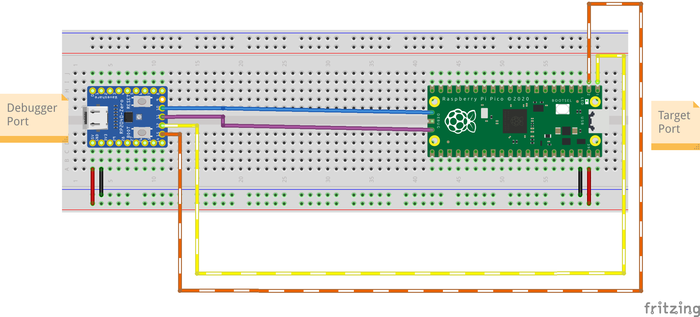

## Pinout

Check the [RPi Pico Pinout Labels](https://pico.pinout.xyz/)


| Zero Pin | Debugger Function |<->| Pico Pin | Target Function | Notes |
|----------|-------------------|---|----------|-----------------|-------|
| 9        | N/A               |   |          |                 |       |
| 10       | SWCLK             |   | CLK      | SWCLK           |       |
| 11       | SWDIO             |   | DIO      | SWDIO           |       |
| 12       | UART0 TX          |   | 1        | UART RX         | [^1]  |
| 13       | UART0 RX          |   | 0        | UART TX         | [^1]  |



[^1]: Target pins depends on the setup of your target board

# How to use

- Download the UF2 firmware from the [Release](https://github.com/icpmoles/zeroprobe/releases) page.

- Flash it on the RP2040-Zero:

    - With the USB cable disconnected

    - Keep pressed the BOOT button

    - Connect the USB cable

    - An external memory device will appear

    - Drag and drop the `zephyr.uf2` file downloaded before

- Connect the two boards as shown above

- **[OPTIONAL]** Test with `pyOCD`

    - Install with `sudo apt install python3-pyocd`

    - Check the device with: `pyocd list`

    ```bash
    $ pyocd list               
    #   Probe/Board                          Unique ID          Target  
    ----------------------------------------------------------------------
    0   Zephyr Project Zeroprobe CMSIS-DAP   xxxxxxxxxxxxxxxx   n/a    
    ```

- **[OPTIONAL]** Test with `probe-rs`

    ```bash
    $ probe-rs list
    The following debug probes were found:
    [0]: Zeroprobe CMSIS-DAP -- 2fe3:2ef0-4:xxxxxxxxxxxxxxxx (CMSIS-DAP)

    $ probe-rs benchmark --chip RP2040 --address 0x20000000

    Probe: Probe type CMSIS-DAP V2 IF: 4 DESC: Some(InterfaceAltSetting { interface_number: 4, alternate_setting: 0, num_endpoints: 2, class: 255, subclass: 0,protocol: 0, string_index: Some(7), endpoints: [Endpoint { address: 0x03, direction: Out, transfer_type: Bulk, max_packet_size: 64, packets_per_microframe:1, interval: 0 }, Endpoint { address: 0x85, direction: In, transfer_type: Bulk, max_packet_size: 64, packets_per_microframe: 1, interval: 0 }] }), debug interface not specified, target chip RP2040

    Test: Speed 3000, Word size 32bit, Data length 4 bytes, Number of iterations 5
    Results: Read: 3779.65 bytes/s Std Dev 281.00, Write: 802960.41 bytes/s Std Dev 702031.03

    Test: Speed 3000, Word size 32bit, Data length 32 bytes, Number of iterations 5
    Results: Read: 13977.55 bytes/s Std Dev 2158.35, Write: 14192.47 bytes/s Std Dev 680.97

    Test: Speed 3000, Word size 32bit, Data length 128 bytes, Number of iterations 5
    Results: Read: 21714.88 bytes/s Std Dev 98.92, Write: 21079.25 bytes/s Std Dev 180.72

    Test: Speed 3000, Word size 32bit, Data length 2048 bytes, Number of iterations 5
    Results: Read: 24615.24 bytes/s Std Dev 170.70, Write: 24802.63 bytes/s Std Dev 119.16

    Test: Speed 3000, Word size 32bit, Data length 32768 bytes, Number of iterations 5
    Results: Read: 25305.23 bytes/s Std Dev 66.51, Write: 24417.86 bytes/s Std Dev 156.50
    ```


## SWD/DAP

This should be automatically detected by your SDK if it uses openOCD/pyOCD/probe-rs.

## TTY

On Linux this will expose two serial ports: one reporting the logs of the debugger, and one forwarding the target UART.

Assuming you don't have anything else connected and that you have [tio](https://github.com/tio/tio) installed:


```bash
$ ls /dev
# this will show all the devices connected, we are interested in:
# ttyACM0 = UART bridge
# ttyACM1 = zeroprobe logs
$ tio /dev/ttyACM0
```

The target UART can also be read from the browser with the
[Zeroprobe Terminal](terminal.html) (Chrome, Edge or other Chromium based
browsers). In the port chooser pick the first of the two Zeroprobe ports.

The baud rate chosen in the terminal, or in `tio -b <baud>`, is applied to the
target UART (115200 by default).

## LED Colors

The RGB LED on the RP2040-Zero shows the state of the USB connection:

| Color  | Meaning                                                                 |
|--------|-------------------------------------------------------------------------|
| Off    | No power, the firmware is not running, or the board is in BOOT mode     |
| Red    | Powered and running, but not configured by a USB host                   |
| Blue   | Configured by the host and ready, no USB traffic                        |
| Green  | USB traffic in the last 0.5 s, on the debugger or on a serial port      |

- **Red** is shown at boot and after a USB reset. If it stays red while
  connected to a computer, the host did not set up the device: check that
  the cable supports data (not charge-only) and see [Fixes](#fixes).

- **Blue** means the probe is ready to use.

- **Green** turns on whenever the host and the probe exchange data: a debugger
  session (pyOCD, OpenOCD, probe-rs), or data on one of the two
  [serial ports](#tty). It returns to blue after 0.5 s without traffic, so it
  flickers between green and blue with intermittent traffic and stays green
  while a debugger is polling. The debugger on the host generates traffic
  with the probe even with no target attached.

The colors and the timeout can be changed, see [Configure](#configure).

# Fixes

In case of device not detected:

- Check with lsusb:
    ```bash
    $ lsusb -d 2fe3:                                                 
    Bus 005 Device 005: ID 2fe3:2ef0 NordicSemiconductor Zeroprobe CMSIS-DAP
    ```
- Add the udev rules for OpenOCD

    - `sudo nano /etc/dev/rules.d/60-openocd.rules`

    - Copy the content of [this file](https://github.com/openocd-org/openocd/blob/master/contrib/60-openocd.rules)

    - `sudo udevadm control --reload`


## TODO

- Use the addressable RGB LED to display information

# Build

Requisites:

- Zephyr SDK 1.0.1

- Zephyr 4.4

- Python 3.12 or newer, git, CMake, Ninja and the other
  [Zephyr host dependencies](https://docs.zephyrproject.org/latest/develop/getting_started/index.html#install-dependencies)

## Set up the workspace

Zeroprobe is a [west](https://docs.zephyrproject.org/latest/develop/west/index.html)
manifest repository: `west.yml` pins Zephyr and the modules it needs
(`cmsis_6` and `hal_rpi_pico`), so a single `west init` creates the whole
workspace.

```bash
$ python3 -m venv zeroprobe-ws/.venv
$ source zeroprobe-ws/.venv/bin/activate
$ pip install west

$ west init -m https://github.com/icpmoles/zeroprobe zeroprobe-ws
$ cd zeroprobe-ws
$ west update
$ west packages pip --install
$ west sdk install -t arm-zephyr-eabi
```

This creates the following layout, the same one used by the CI:

```
zeroprobe-ws/
├── .venv/        # Python virtual environment with west
├── .west/        # workspace config, created by west init
├── external/     # Zephyr and modules, fetched by west update
└── zeroprobe/    # this repository
```

If you already cloned the repository, run `west init -l zeroprobe` from its
parent directory instead of `west init -m ...`, then continue with
`west update`.

To build a branch other than `main`, add `--mr <branch>` to `west init -m`.

## Compile

The board (`rp2040_zero/rp2040`) is already selected in `CMakeLists.txt`:

```bash
$ cd zeroprobe
$ west build
```

The firmware is written to `build/zephyr/zephyr.uf2`, flash it as described in
[How to use](#how-to-use), or run `west flash --runner=uf2` while the board is in BOOT mode.

Use `west build -p` for a pristine build, e.g. after changing `west.yml` or
switching branch.

## Configure

Options can be changed in `prj.conf`, in `boards/rp2040_zero.conf`, or
interactively with `west build -t menuconfig`.

The status LED is set in `boards/rp2040_zero.conf`:

| Option                              | Default    | Meaning                                    |
|-------------------------------------|------------|--------------------------------------------|
| `CONFIG_APP_LED_COLOR_UNCONFIGURED` | `0x200000` | Not configured by a USB host (red)         |
| `CONFIG_APP_LED_COLOR_CONFIGURED`   | `0x000020` | Configured by the host, no traffic (blue)  |
| `CONFIG_APP_LED_COLOR_ACTIVE`       | `0x002000` | USB traffic (green)                        |
| `CONFIG_APP_LED_IDLE_TIMEOUT_MS`    | `500`      | Idle time before going back to configured  |

Colors are `0xRRGGBB`, keep the values low: the WS2812 is very bright.

The colors and the timeout can also be changed at runtime from the shell on
the logs serial port (see [TTY](#tty)), without rebuilding:

```
uart:~$ led show
unconfigured 0x200000
configured   0x000020 (current)
active       0x002000
timeout      500 ms
uart:~$ led set configured 0x100010
uart:~$ led timeout 1000
uart:~$ led save
```

| Command                                                  | Effect                                                 |
|----------------------------------------------------------|--------------------------------------------------------|
| `led show`                                               | Show the settings, and which color is currently shown  |
| `led set <unconfigured\|configured\|active> <RRGGBB>`    | Change a color until the next reboot                   |
| `led timeout [ms]`                                       | Show or change the idle timeout (1 to 60000 ms)        |
| `led save`                                               | Save the settings to flash, they are loaded at boot    |
| `led reset`                                              | Erase the saved settings and go back to the defaults   |

Saved settings are kept in the last 4 KB sector of the flash, which is not
touched when flashing a new UF2 firmware.

# Credits

- [Zephyr RTOS](https://www.zephyrproject.org/)

- [DAPLink](https://github.com/armmbed/daplink)

- Images created with [Fritzing](https://fritzing.org/)

- Boards footprint created by Vanepp: [RP2040-Zero](https://forum.fritzing.org/t/part-request-waveshare-rp2040-zero/16705/2) & [RPi Pico](https://forum.fritzing.org/t/looking-for-raspberry-pi-pico-part/11915/19) 

- Favicon from "Noto Emoji Font"

# Footnotes